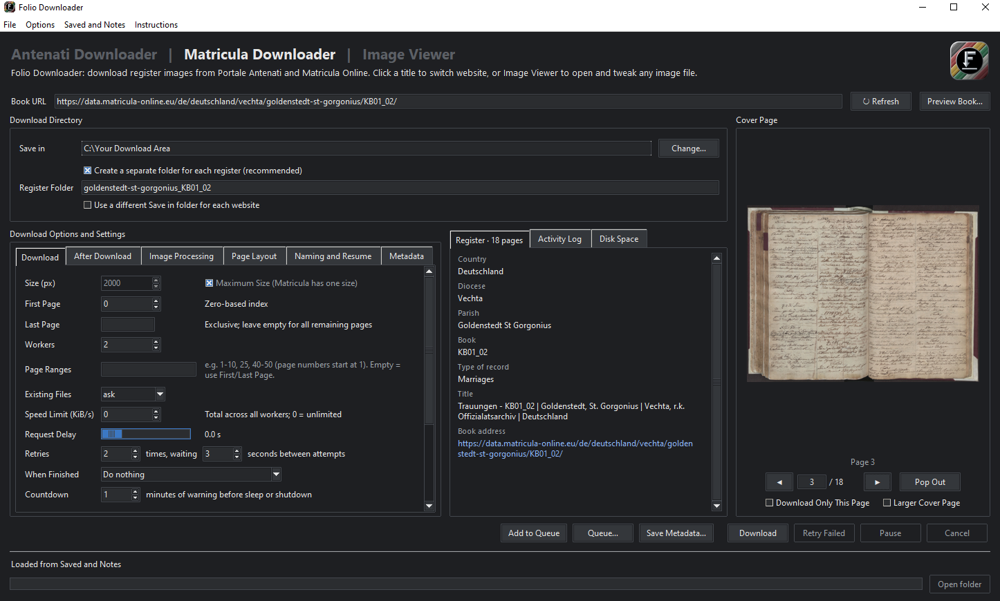
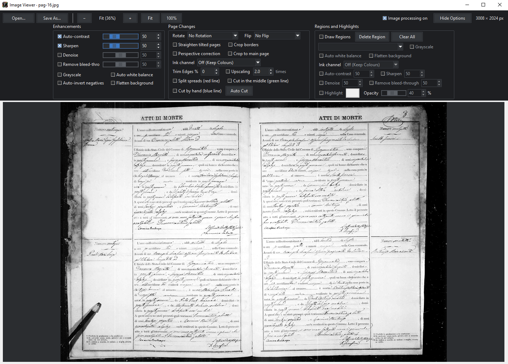

# Folio Downloader

  

Folio Downloader downloads complete register images from Portale Antenati (Italian civil and parish records) and Matricula Online (church books), then helps you clean up, preview and package them: all from one desktop window, or from the command line.

## Features

### Downloading

Paste an Antenati gallery or IIIF manifest URL, or a Matricula book URL, and download the whole register or just the pages you choose (1-10, 25, 40-50).
Resumable downloads, with optional strict resume that re-checks existing files (SHA-256) and re-downloads damaged ones.
Queue, saved URLs, notes and history; a cover page / register preview before you commit to a download.
Adjustable image size, parallel workers, delay between requests, and automatic retries.
Descriptive file names or your own name template (for example {town}_{typology}_{year}_pg{index}).

### Cleaning up pages

Auto-contrast, sharpen, denoise, remove bleed-through, grayscale, auto white balance, auto-invert negatives, flatten background.
Straighten tilted pages, crop borders, perspective correction, crop to the main page, trim edges, upscaling.
Split two-page spreads at the gutter (or in the middle), saving name_left and name_right.
Keep untouched originals alongside the processed pages.

### Output

Image folders, or a single PDF or CBZ (optionally split into volumes by page count or size, with blank pages skipped).
Optional OCR to make the PDF searchable (needs Tesseract).
Metadata embedded in each JPEG (source URL, archive, year, page), plus CITATION.txt and SHA256SUMS.txt.
Smaller "copies for sharing".

### Image Viewer and Pop Out

Open any picture on your computer, adjust it and Save As… (your original is never overwritten).
Preview every enhancement before downloading.
Cuts: red line (detects the gutter), green line (exact middle) or blue line (drag by hand): one at a time.
Per-region processing: draw boxes around parts of a page and give each its own settings.
Highlights: coloured highlights with adjustable opacity (Image Viewer).
Installation
Windows (packaged app)
Download Folio-Downloader.exe from the latest release.
Run it. No installation is needed.

The app can check this repository for newer releases from inside the program.

### From source

Requires Python 3.11 or newer (with Tkinter).

bash
git clone https://github.com/JStiens1/Folio-Downloader.git
cd Folio-Downloader
pip install typer requests rich python-slugify pillow
python Folio_Downloader.py

### Optional extras:

Feature	What you need
Matricula pages that need a browser	pip install selenium and Google Chrome
Searchable PDFs (OCR)	the Tesseract program and its language data

Check the imports at the top of the script for the exact package list for your version.

### Usage
Desktop app
bash
python Folio_Downloader.py

Run with no arguments to open the window. Pick Antenati Downloader, Matricula Downloader or Image Viewer from the titles at the top, paste a URL, preview the cover and press Download. The built-in Instructions window explains every option.

### Command line
bash
python Folio_Downloader.py "<register-url>" [options]

### Examples:

bash
Whole register at the default size
python Folio_Downloader.py "https://antenati.cultura.gov.it/detail-nominative/?s=..."

Pages 1-20 and 40-50, straightened and contrast-stretched, saved as a PDF
python Folio_Downloader.py "<url>" --pages "1-20, 40-50" --deskew --auto-contrast --compile pdf

See the plan without downloading
python Folio_Downloader.py "<url>" --dry-run

### Useful options (run with --help for the complete list):

Option	Meaning
-s, --size	Image size in pixels (0 = full size)
-n, --workers	Concurrent downloads
--pages	Pages to download, e.g. 1-10, 25
-o, --output	Exact output folder
--compile pdf|cbz	Build a single PDF or CBZ afterwards
--deskew, --autocrop, --denoise	Page clean-up
--embed-metadata	Write source details into each JPEG
--retries, --retry-wait	Retry failed pages
Building the executable
bash
pip install pyinstaller
pyinstaller --onefile --windowed --icon Downloader.ico --name "Folio-Downloader" Folio_Downloader.py

The icon is also embedded in the program, so the window and taskbar icon work inside the packaged exe.

Settings and files

Settings and notes are stored in your home folder as .folio_downloader_prefs.json and .folio_downloader_notes.json.

### Responsible use

Folio Downloader fetches pages from public archive websites. Please be considerate: keep the worker count modest, use the delay option on long downloads, and follow the terms of use and reuse conditions of Portale Antenati and Matricula Online. Folio Downloader is an independent project and is not affiliated with either site.

### Contributing

Bug reports and pull requests are welcome. When reporting a problem, please include the register URL (if it is public), the options you used, and the message shown in the app.

### License

Folio Downloader is free software, licensed under the GNU General Public License v3.0. See the LICENSE file for the full text.

This program is distributed in the hope that it will be useful, but without any warranty; without even the implied warranty of merchantability or fitness for a particular purpose.

Third-party libraries it uses keep their own licenses. Before distributing a built .exe, check that each bundled library's license (including the Antenati library) is compatible with the GPL v3 and keep their notices.
